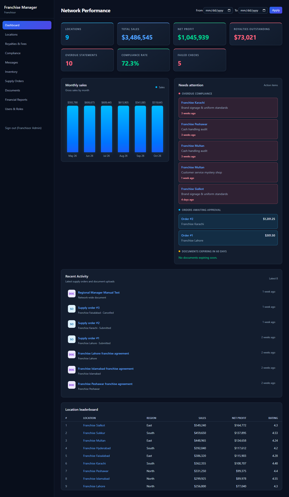
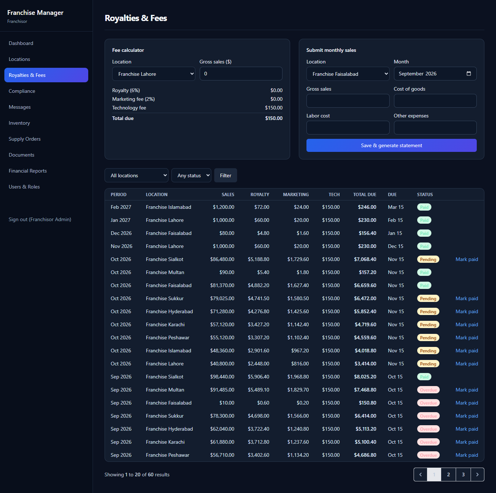
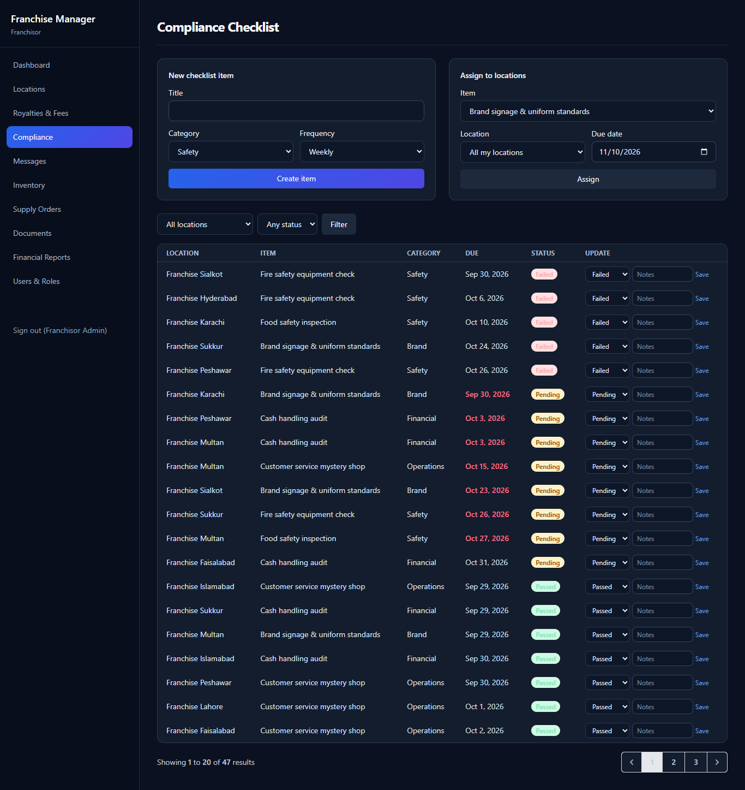
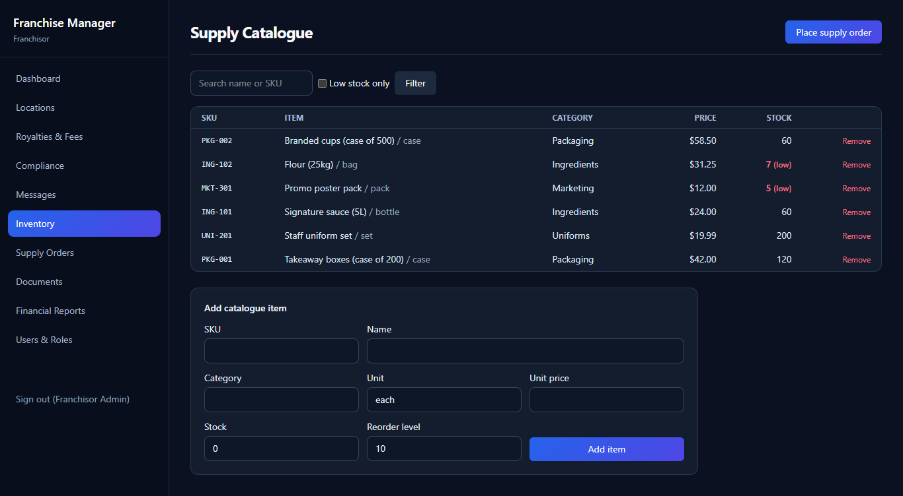
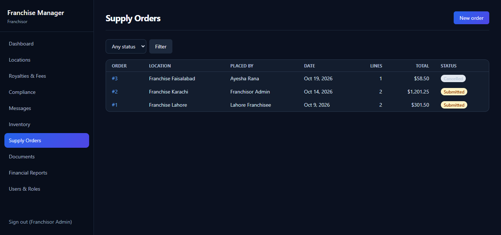

# Laravel Franchise Management Dashboard

A Laravel web application for managing franchise locations, royalty payments, compliance checks, inventory, documents, communications, and financial performance from a centralized dashboard.

**Technology stack:** Laravel 13, PHP 8.3+, Blade, Vue 3, Tailwind CSS, Laravel Sanctum, MySQL/PostgreSQL/SQLite, Docker, and GitHub Actions.

## Application Screenshots

### Dashboard


### Royalties Management


### Compliance Management


### Inventory Management


### Supply Orders


## Features

| # | Feature | Description |
|---|---|---|
| 1 | Multi-location dashboard | KPIs, monthly sales charts, location rankings, alerts, and date filtering |
| 2 | Royalty and fee management | Royalty calculations, monthly sales entry, statements, payment tracking, and overdue detection |
| 3 | Compliance management | Assign compliance checks to locations, record results, and add notes |
| 4 | Franchisee communication | Threaded messages, replies, and network-wide announcements |
| 5 | Inventory and supply orders | Product catalogue, stock validation, order status management, and stock adjustments on cancellation |
| 6 | Document management | Upload and download documents, track expiry dates, and manage location-specific or network-wide documents |
| 7 | Financial reporting | Location-level financial reports, fee summaries, and CSV exports |
| 8 | Role-based access control | Separate permissions for franchisors, regional managers, and franchisees |

Additional functionality includes a REST API, scheduled overdue-royalty processing, Docker configuration, and automated tests.

## Technology

- **Backend:** Laravel 13 and PHP
- **Frontend:** Blade templates, Vue 3, and Tailwind CSS
- **API authentication:** Laravel Sanctum
- **Database:** SQLite, MySQL, or PostgreSQL
- **Deployment tooling:** Docker and Docker Compose
- **Continuous integration:** GitHub Actions
- **Testing:** PHPUnit and Laravel's testing framework

## Requirements

For a local installation, you need:

- PHP 8.3 or later
- Composer 2
- Node.js 20 or later and npm
- A supported database
- Git

## Installation

This repository contains the application's code, including its controllers, models, views, migrations, routes, configuration, and tests. It is intended to be installed into a compatible Laravel application.

### 1. Clone this repository

```bash
git clone https://github.com/ayesharana201/franchise-management-dashboard.git
cd franchise-management-dashboard
```

### 2. Create a Laravel application

Create a separate Laravel 13 application and install its dependencies:

```bash
composer create-project laravel/laravel franchise-app "^13.0"
cd franchise-app
php artisan install:api --no-interaction
```

### 3. Copy the application files

Copy the contents of this repository into the new Laravel application directory, following the project structure. Review existing files before overwriting them, particularly `bootstrap/app.php`, configuration files, routes, and database migrations.

Do not copy the repository's `.env.example` over an existing working `.env` file without reviewing the settings.

### 4. Configure the application

Create or update the local environment file:

```bash
php artisan key:generate
```

Configure the database settings in `.env`. For example, SQLite can be used for local development when the database connection is configured accordingly.

### 5. Install frontend dependencies

```bash
npm install
npm run build
```

### 6. Create the database and demo data

After configuring the database, run:

```bash
php artisan migrate --seed
```

The seeder creates sample franchise locations, users, sales records, royalty statements, compliance checks, inventory, orders, messages, and documents.

### 7. Run the application

```bash
php artisan serve
```

Open `http://localhost:8000` in your browser.

### 8. Run the tests

```bash
php artisan test
```

**Important:** Review the installation steps against the current repository before using them on a fresh machine. This repository does not currently include the automated `setup.ps1` or `setup.sh` scripts.

## Demo accounts

The database seeder defines the following local development accounts. The configured password is `password`.

| Role | Email | Access scope |
|---|---|---|
| Franchisor | `admin@franchise.test` | Network-wide administration |
| Regional manager | `north.manager@franchise.test` | North region |
| Franchisee | `lahore@franchise.test` | Assigned franchise location |

These accounts are intended for local demonstration and testing. Do not use these credentials in a production deployment.

## Database configuration

SQLite, MySQL, and PostgreSQL are supported by the application's configuration.

For MySQL or PostgreSQL, set the appropriate environment variables in `.env`:

```dotenv
DB_CONNECTION=mysql
DB_HOST=127.0.0.1
DB_PORT=3306
DB_DATABASE=franchise
DB_USERNAME=your_database_user
DB_PASSWORD=your_database_password
```

Use credentials appropriate to your own environment. Never commit `.env` or real database passwords to GitHub.

After configuring the database, run:

```bash
php artisan migrate --seed
```

## Docker

The repository includes a `Dockerfile` and `docker-compose.yml` for a containerized environment.

Configure the required environment variables and a strong database password before starting the services. Then run:

```bash
docker compose up -d --build
docker compose exec app php artisan key:generate
docker compose exec app php artisan migrate --seed --force
```

The Nginx service is configured to expose the application on port `8080`.

Review the Docker configuration and environment settings before using this setup outside local development. Back up any important data before removing Docker volumes.

## Tests

Run the automated test suite with:

```bash
php artisan test
```

The test suite includes coverage for royalty calculations, role and location access restrictions, compliance workflows, document handling, reports, API authentication, supply orders, and overdue-royalty processing.

See `docs/TESTING.md` for additional information.

## Project structure

```text
app/
  Console/Commands/       Scheduled and console commands
  Http/Controllers/       Web and API controllers
  Http/Middleware/        Access-control middleware
  Models/                 Eloquent models
  Notifications/          Application notifications
  Services/               Business logic and calculations

database/
  migrations/             Database schema
  seeders/                Demo data

resources/
  css/                    Stylesheets
  js/                     Frontend JavaScript
  views/                  Blade templates

routes/
  web.php                 Web routes
  api.php                 API routes

tests/
  Feature/                Feature tests
  Unit/                   Unit tests


## Dashboard Preview


docs/                     Project documentation
```

## Documentation

- `docs/ARCHITECTURE.md` — system architecture and access-control design
- `docs/API.md` — REST API documentation
- `docs/USER_GUIDE.md` — application usage guide
- `docs/TESTING.md` — test documentation
- `docs/KNOWN_ISSUES.md` — known limitations and outstanding issues

## Security

- Keep `.env` and production credentials private.
- Use strong passwords and environment-specific configuration.
- Do not use demo credentials in production.
- Verify authorization rules before exposing the application publicly.

## License

No license has been specified. Contact the repository owner regarding permissions to reuse or distribute this project.