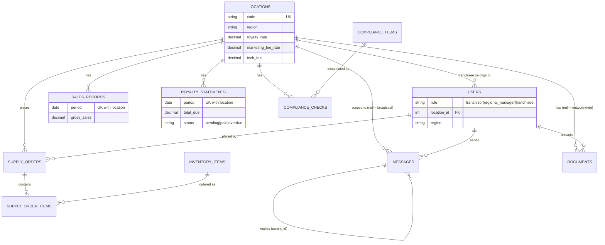

# Architecture

## Overview

A server-rendered Laravel monolith with a thin REST API for integrations.

```
Browser (Blade + Vue 3 + Tailwind)          API clients (Bearer token)
        │  session + CSRF                          │  Sanctum token
        ▼                                          ▼
   routes/web.php                             routes/api.php
        │                                          │
        └──────────── middleware: auth, role ──────┘
                              │
                 Controllers (validation + authorization)
                              │
              Services: RoyaltyCalculator · ReportService
                              │
                    Eloquent models → MySQL / PostgreSQL / SQLite
                              │
        Scheduler → royalties:mark-overdue → Mail notifications
```

## Access control

Authorization is enforced in two layers so a missed check in one place can't expose data:

1. **Route middleware** (`role:...`) gates whole actions (e.g. only franchisors create locations).
2. **Query/object scoping** — `Location::visibleTo($user)` restricts every list query, and `authorizeLocation()` / `User::canAccessLocation()` guards single records. A user can only ever reach data for locations in their scope.

| Capability | Franchisor | Regional manager | Franchisee |
|---|:-:|:-:|:-:|
| Scope | All locations | Locations in their region | Their one location |
| View dashboard, reports, statements | ✓ | ✓ (region) | ✓ (own) |
| Create / edit / delete locations | ✓ | – | – |
| Manage users and roles | ✓ | – | – |
| Submit monthly sales | ✓ | ✓ | ✓ (own) |
| Mark royalty paid | ✓ | ✓ | – |
| Create/assign compliance items | ✓ | ✓ | – |
| Complete compliance checks | ✓ | ✓ | ✓ (own) |
| Send network announcements | ✓ | ✓ | – |
| Message head office | ✓ | ✓ | ✓ (own location) |
| Edit supply catalogue | ✓ | – | – |
| Place supply orders | ✓ | ✓ | ✓ (own) |
| Change order status | ✓ | ✓ | – |
| Upload documents | ✓ | ✓ | ✓ (own location only) |

## Key business rules

- **Fees:** `royalty = gross × royalty_rate%`, `marketing = gross × marketing_fee_rate%`, plus a flat monthly `tech_fee`. Rates are per location. All amounts rounded to cents (`RoyaltyCalculator`).
- **Statements:** Saving monthly sales creates or refreshes that month's statement (unique per location + month). Paid statements are never rewritten. Due date is the 15th of the following month.
- **Overdue:** Unpaid statements past their due date become `overdue` (on page load and via the daily command, which also emails the location's franchisee once).
- **Orders:** Created in a DB transaction with row locks; stock is decremented, insufficient stock rejects the whole order, cancelling returns stock exactly once, and cancelled orders are immutable.
- **Documents:** Stored on the private `local` disk (not publicly web-accessible); downloads go through an authorization check.

## Data model



## Technology choices

- **Blade + Vue 3:** Pages are server-rendered; Vue is used only where live interaction helps (fee calculator, order form totals). Vue is loaded from a CDN for simplicity — bundle it through Vite (`npm i vue`) if your deployment must not call third-party CDNs.
- **Tailwind CSS:** via Vite when `npm run build` has been run; the layout falls back to the Tailwind CDN otherwise so the app still renders.
- **Sanctum:** simple bearer tokens for the API. (The original plan mentioned JWT/OAuth; Sanctum is Laravel's first-party equivalent for first-party API clients.)
- **Database portability:** Standard Eloquent and portable SQL only; tested against SQLite, intended for MySQL/PostgreSQL.

## Deployment

`Dockerfile` (multi-stage: Vite build → Composer → php-fpm) and `docker-compose.yml` (app, nginx, scheduler, MySQL). `.github/workflows/ci.yml` runs the test suite on every push/PR and builds and pushes an image to GHCR on `main`. Server provisioning (AWS/DigitalOcean) and monitoring/backups are environment-specific and not included.
